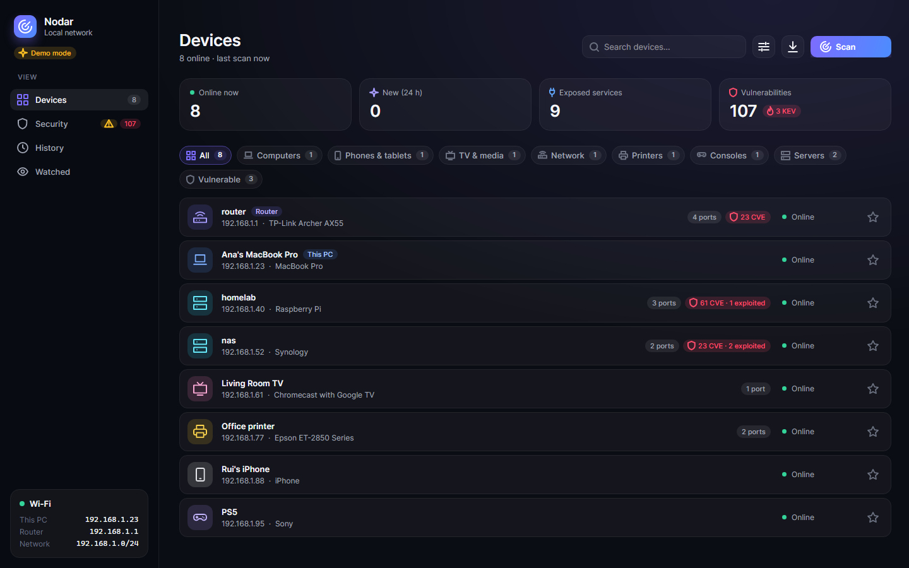
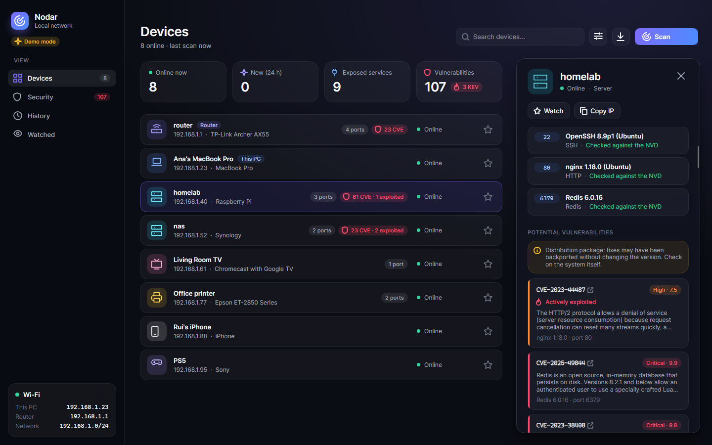
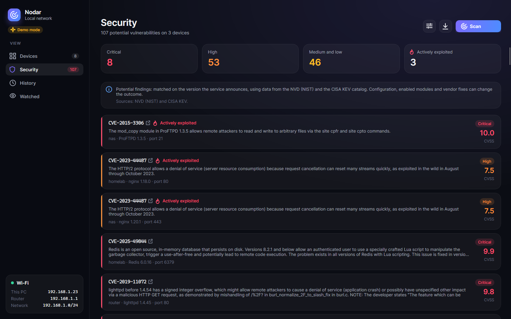

<p align="center">
  
</p>

<h1 align="center">Nodar</h1>

<p align="center"><a href="README.md">Português</a> · <b>English</b></p>

> See who's on your local network, identify every device, and get notified when someone new shows up.

A Windows app built with C# / .NET 9 and an [Avalonia](https://avaloniaui.net/) interface. It scans your LAN and shows every device with its IP, MAC, manufacturer, hostname, type, likely operating system, exposed services and known vulnerabilities. It keeps a history of who joined and left the network.

> **Status:** under active development.

<p align="center">
  
</p>

| Device details | Security |
|---|---|
|  |  |

<sub>Captured in [demo mode](#demo-mode): a fictional network with real CVEs from the NVD.</sub>

---

## Features

### Interface
- Dark and translucent (Acrylic/Mica on Windows 11), with a sidebar and four views: **Devices**, **Security**, **History** and **Watched**.
- Device list with an icon and color per type, badges (*Router*, *This PC*, *New*), open ports and vulnerabilities. Search by name, IP, MAC or manufacturer.
- **Filters** above the list, with counts: by type (computers, phones & tablets, TV, network, printers, smart home…) and by state (vulnerable, watched, new, offline). Only the ones present on your network are shown, and they combine with search.
- Details panel with the device information, its services and the check status of each one, vulnerabilities (CVSS, active exploitation, link to the NVD) and activity.
- Scan options in their own panel. Preferences are saved.
- Unobtrusive in-app notices: no dialogs interrupting you, no focus stealing.
- **English and Portuguese**: follows the Windows language, or pick one in the options. Switches instantly without a restart, and also applies to notifications and reports.

### Device discovery
- Detects the local network automatically: interface, IP, subnet mask, gateway and range. Virtual adapters (VPN, Hyper-V, VirtualBox…) are ignored.
- **ARP** discovery across the whole subnet: Windows resolves every address in parallel and Nodar reads the neighbor table (`GetIpNetTable2`). A /23 network (510 addresses) takes about 3 s, without administrator rights.
- **Doesn't rely on ping**: locked iPhones, Macs with a firewall, printers and many IoT devices ignore ping, but always answer ARP.
- Networks of up to 1024 addresses are always swept in full; **Full subnet** extends the sweep to larger networks.
- Names from reverse DNS (the name your router assigns) and from **Bonjour/mDNS**: Macs, iPhones, iPads, Apple TV, Chromecast and printers announce their name ("Ana's MacBook Pro") and model.
- **SSDP/UPnP**: smart TVs, set-top boxes, consoles and routers publish their name, manufacturer and model (for example, the exact router model). **NetBIOS**: names of Windows PCs and NAS devices.
- **Manufacturer** from the official IEEE registry (about 40,000 vendors), downloaded and cached. Devices with a **private Wi-Fi address** (randomized MAC) are shown as such and identified through Bonjour.
- **Device type** from the model, manufacturer and hostname: router, computer, phone, TV, printer, game console, camera, smart home, server…
- Devices behind a **Wi-Fi repeater** that share the same MAC stay separate (identified by MAC+IP).
- Marks the device that is this PC.

### Analysis
- **Port scan** of the most common TCP ports, including typical router ports (TR-069, UPnP). The router is scanned too.
- **Service detection** from banners, including HTTPS (TLS) and the DNS server version (`version.bind`). Probes never send credentials or login attempts.
- **Operating system detection** from the TCP/IP fingerprint (TTL, window size, MSS, DF flag), with a confidence level.
- **Known vulnerability checks** with official data from the [NVD](https://nvd.nist.gov/) (NIST) and the [CISA KEV](https://www.cisa.gov/known-exploited-vulnerabilities-catalog) catalog. See [How vulnerability checking works](#how-vulnerability-checking-works).
- **Certificates and TLS**: on TLS services (HTTPS, IMAPS…) it reads the certificate and protocol, and flags expired or expiring certificates, weak keys and signatures, obsolete protocols the server still accepts (SSL 3.0, TLS 1.0 and 1.1), and the same factory self-signed certificate on several devices. A self-signed certificate on its own isn't flagged: it's normal on routers and IoT.
- **Ports opened by the router (UPnP)**: asks the router, with anonymous read-only queries, which ports it opened to the internet, for which device and since when. It highlights exposed remote access, file sharing, databases and cameras, and warns when a new port appears (the temporary ones from games and calls only warn inside the app). It can be turned off in the Options.
- **What the internet sees**: on request (a button on the *Security* page), it queries the [Shodan InternetDB](https://internetdb.shodan.io/) to show the open ports and CVEs the internet links to your public address, and which of those ports the router opened through UPnP. It never runs by itself. See [Privacy and network](#privacy-and-network).

### Monitoring
- **Persistent history** of every device: when it was first seen and when it joined and left. Devices are identified by MAC, so a new DHCP address doesn't create a "new" device.
- **New devices**: a notice when a device that has never been seen before appears. The first scan is the baseline.
- **Router MAC**: remembers the MAC the router answers with and warns if it changes. On its own, a change is a weak signal (you replaced the router, or you're on another network with the same address, and you can accept the MAC). If another device on the network has exactly that MAC, the alert is strong: the typical trace of ARP spoofing, someone impersonating the router.
- **Watched devices**: tap a device's star and get notified when it joins or leaves. To avoid false alarms from sleeping phones, a device only counts as gone after missing two scans in a row.
- **Auto refresh** with a configurable interval (1 to 15 minutes).
- **Windows notifications** (Action Center) when the window isn't visible: new devices (several are grouped into one notification), and watched devices joining or leaving. Clicking the notification opens Nodar.
- **Background mode**: closing the window keeps Nodar in the system tray, watching the network (icon menu: *Open*, *Scan now*, *Quit*). Optionally, **start with Windows**, already minimized.
- **Single instance**: opening Nodar again brings the existing window to the front.
- Option to show or hide offline devices.

### Export and reports
- Export the device list to **CSV**.
- **Audit report** in **HTML**, **JSON** or **Markdown**.

### In progress
The code for these already exists in `Nodar.Core`, but it isn't wired into the interface or the scan yet:
- Advanced port scanner (SYN / FIN / XMAS / NULL / ACK modes)
- Traceroute with route analysis
- Scan speed profiles (*Paranoid* to *Insane*)

---

## Requirements

- **Windows 10 or 11** (x64)
- To build: [.NET 9 SDK](https://dotnet.microsoft.com/download/dotnet/9.0)
- **Recommended:** run as **Administrator**. Without elevated rights, ARP discovery and some checks give incomplete results (the app tells you when that's the case).

---

## Usage

### Option 1: prebuilt executable
Download the `.exe` from the [Releases](../../releases) page. It's a single file that doesn't need .NET installed. Run it, ideally as Administrator.

### Option 2: run from source
```bash
git clone <repository-url>
cd <repository-folder>
dotnet run --project src/Nodar.App
```
You can also use [`run.bat`](run.bat).

### Option 3: build the executable
```bash
build.bat
```
Builds a single self-contained executable at `dist/Nodar.exe`. [`Abrir Nodar.bat`](Abrir%20Nodar.bat) opens it, building it first if needed.

### Demo mode
```bash
dist\Nodar.exe --demo
```
Shows a fictional network with outdated services, so you can see the interface with vulnerabilities without a vulnerable network. The devices are made up, but the services are checked against the real NVD, so the CVEs are genuine for those versions. It uses a temporary folder and never touches your history.

To regenerate the README screenshots (rendered off-screen, so nothing from your desktop shows up):
```bash
dotnet run --project tools/Screenshots -- docs/screenshots --demo --lang pt
dotnet run --project tools/Screenshots -- docs/screenshots/en --demo --lang en
```

### Tests
```bash
dotnet test
```

---

## How vulnerability checking works

Turn on **Open ports**, **Services** and **Vulnerabilities**. For each service with a banner, Nodar:

1. **Identifies the product and version** from the banner. For example, `SSH-2.0-OpenSSH_8.9p1 Ubuntu-3ubuntu0.10` gives OpenSSH 8.9p1, Ubuntu package. The version is never guessed: without a version in the banner, the service is marked *version unknown*.
2. **Downloads that product's CVEs from the NVD** and evaluates the affected-version rules locally (ranges and exact versions). The comparison understands real-world formats such as `8.2p1`, `1.3.5e` or `1.0rc1`.
3. **Flags CVEs with confirmed active exploitation** using the CISA KEV catalog, including those used in ransomware.

Each service shows its check status: *checked*, *checked with cached data*, *version unknown*, *product not supported* or *NVD unreachable*. A service that wasn't checked is never shown as "no vulnerabilities".

**Supported products:** OpenSSH, Dropbear, Apache HTTP Server, nginx, Microsoft IIS, lighttpd, Jetty, vsftpd, ProFTPD, FileZilla Server, Exim, MySQL, MariaDB, Redis, plus the ones common on routers: dnsmasq (including Pi-hole), Unbound, ISC BIND, MiniUPnPd and libupnp (the UPnP stack of many routers, read from the SSDP announcement).

**Important:** findings are *potential*.
- A version match doesn't prove the flaw is there. Configuration, enabled modules and platform can change the outcome.
- Distributions such as Ubuntu, Debian and RHEL ship fixes without changing the version number ("backports"). Nodar warns you when it detects a distribution package; in those cases, check on the system itself.

### Privacy and network
- Only the **product identifier** is sent to the NVD (e.g. `cpe:2.3:a:openbsd:openssh`). **No IPs, MACs, hostnames or detected versions are sent.** Version matching happens on your PC.
- The KEV catalog is downloaded in full, with none of your data.
- To identify manufacturers, Nodar downloads the public IEEE registry (`standards-oui.ieee.org`) once a month. None of your data is sent.
- TLS inspection stays on the local network: one handshake that doesn't validate the chain and sends no data, plus three `ClientHello`s (SSL 3.0, TLS 1.0 and 1.1) just to see whether the server answers, with no key exchange. It's part of the *Services and versions* option.
- Reading the router's UPnP (open ports and external address) is an anonymous, read-only query to the router itself, on the local network: only the router's IP is contacted, nothing is ever changed and there are no credentials. It can be turned off in the Options.
- **"What the internet sees"** only runs when you press the button, and it's the only feature that sends something off your PC: your **public address**, to the Shodan InternetDB (free, no account). The address comes from the router itself; if it doesn't say, `api.ipify.org` is asked as well. If the router's address isn't public (CGNAT or double NAT), nothing is looked up. Shodan's data is from its last visit to your address and may be days old.
- ARP, Bonjour/mDNS, SSDP and NetBIOS queries stay on your local network. The UPnP descriptor is only read from the device that announced it, over HTTP on the local network, with size and time limits and without DTD processing (XXE protection).
- Data is cached in `%LOCALAPPDATA%\Nodar\cache\`: NVD data for 3 days, KEV for 1. Without internet, the existing cache is used and the app tells you.

### NVD API key (optional)
Without a key, the NVD allows 5 requests per 30 seconds, so the first lookup of each product takes a few seconds. With a [free key](https://nvd.nist.gov/developers/request-an-api-key) the limit goes up to 50. To set it, use one of:
- the `NVD_API_KEY` environment variable; or
- `%LOCALAPPDATA%\Nodar\settings.json` with `{ "nvdApiKey": "your-key" }`.

---

## Project structure

```
src/Nodar.App/                       # Interface (Avalonia, MVVM)
├── Views/MainWindow.axaml           # Main window and the four views
├── ViewModels/                      # Interface state and commands
│   ├── MainViewModel.cs             # Scan, device list, filters and navigation
│   ├── SettingsViewModel.cs         # Preferences (scan options, background, language)
│   ├── Security/History/WatchlistViewModel.cs  # Security, History and Watchlist views
│   ├── ExposureViewModel.cs         # Ports opened by the router, router MAC, what the internet sees
│   └── ToastHost.cs                 # In-app notices
├── Localization/TExtension.cs       # {l:T key} markup extension for translated text
├── Styles/                          # Theme (colors, shadows), control styles and icons
└── Services/                        # Tray and notifications, single instance, start with Windows, demo

src/Nodar.Core/                      # Logic, no UI
├── Models/NetworkModels.cs          # Models (device, network, history, scan)
├── Localization/                    # Translations: pt.json, en.json (same keys, enforced by tests)
├── Monitoring/DeviceTracker.cs      # History, new and watched devices
├── Monitoring/GatewayGuard.cs       # Router MAC: detects changes and ARP spoofing
├── Monitoring/PortMappingTracker.cs # Ports opened by the router: what's new and since when
├── Settings/AppSettings.cs          # Preferences
└── Services/
    ├── NetworkDiscoveryService.cs   # Scan orchestration (parallel)
    ├── NeighborDiscovery.cs         # ARP discovery (Windows neighbor table)
    ├── MdnsProbe.cs                 # Bonjour/mDNS: name and model
    ├── SsdpProbe.cs                 # SSDP/UPnP: name, manufacturer, model, UPnP stack
    ├── TlsInspector.cs / TlsAnalyzer.cs  # Certificate, protocol and obsolete protocols; the findings from them
    ├── UpnpGatewayClient.cs         # Ports the router opened (UPnP IGD, read-only)
    ├── InternetExposureService.cs   # What the internet sees of the public address (Shodan InternetDB)
    ├── ExposureAdvice.cs            # Sensitive services and when a port deserves a notification
    ├── NetBiosProbe.cs              # NetBIOS name (Windows PCs, NAS)
    ├── DeviceIdentification.cs      # Model → family and type (Mac14,7 → Mac)
    ├── OuiRegistry.cs               # IEEE manufacturer registry
    ├── VendorService.cs             # Manufacturer and device type
    ├── OSFingerprintService.cs      # Operating system fingerprinting
    ├── OSFingerprintDatabase.cs     # OS signatures
    ├── ServiceDetectionService.cs   # Banner grabbing (TCP and TLS, with timeouts)
    ├── DnsVersionProbe.cs           # DNS server version (version.bind)
    ├── Vulnerabilities/
    │   ├── BannerParser.cs          # Product and version from the banner
    │   ├── ProductCatalog.cs        # Supported products and CPE identifiers
    │   ├── VersionComparer.cs       # Version comparison (8.2p1, 1.3.5e, 1.0rc1…)
    │   ├── CpeMatcher.cs            # NVD affected-version rules
    │   ├── NvdParser.cs / NvdClient.cs   # NVD CVE API 2.0
    │   ├── KevClient.cs             # CISA KEV catalog
    │   ├── VulnerabilityCache.cs    # Local cache
    │   └── VulnerabilityService.cs  # Orchestration and per-service check status
    ├── AuditReportService.cs        # HTML / JSON / Markdown reports
    ├── ExportService.cs             # CSV export
    ├── AdvancedPortScanner.cs       # (in progress)
    ├── TracerouteService.cs         # (in progress)
    └── TimingTemplates.cs           # (in progress)
tests/Nodar.Tests/                   # Tests (xUnit), with real NVD responses as fixtures
tests/Nodar.App.Tests/               # Interface tests (Avalonia headless, isolated data)
tools/IconGenerator/                 # Generates the app icon
tools/Screenshots/                   # Generates the README screenshots (headless, demo mode)
docs/screenshots/                    # README screenshots (Portuguese; English in en/)
```

Local data (history, watchlist, router MAC, known open ports, preferences and vulnerability cache) lives in `%LOCALAPPDATA%\Nodar\`.

---

## Limitations

- Only scans the local network the PC is connected to.
- Devices in deep sleep or that drop off Wi-Fi may miss a scan. To avoid false alarms, they only count as "gone" after missing two scans in a row.
- iPhones and Android phones can **rotate their private Wi-Fi address** (for example with "rotating address" on iOS 18). When that happens, they show up as a new device.
- OS detection is **heuristic** and can be wrong, especially for IoT devices.
- Vulnerability checking depends on the banner. Many devices (routers, cameras, IoT) don't announce a version. A version match **doesn't confirm** the device is vulnerable. It's not a substitute for a proper security audit.
- Obsolete-TLS detection only tells you what the server **accepts**: finding nothing doesn't prove it refuses them (a server that doesn't answer in time counts as "doesn't accept"). Only ports 443, 8443, 993 and 995 are inspected.
- CVE descriptions come from the NVD, in English.
- Notifications depend on auto refresh: with it off, Nodar in the tray won't rescan the network on its own.

---

## Roadmap

- [x] Vulnerability data from official sources (NVD / CISA KEV) instead of a static list
- [x] Read HTTPS/TLS banners and include the gateway in the scan
- [x] Identify the router model via UPnP/SSDP
- [ ] Router firmware version (admin pages, TR-069)
- [ ] Wire the advanced scanner, traceroute and timing profiles into the interface
- [x] Modern interface (Avalonia) with logic split into `Nodar.Core`
- [x] Windows notifications and background monitoring (system tray)
- [x] Ports opened by the router (UPnP), router MAC alert and "what the internet sees" (Shodan)
- [ ] Custom names and "trusted devices"
- [x] Identification via Bonjour/mDNS and the IEEE manufacturer registry
- [x] Identification via SSDP/UPnP and NetBIOS
- [x] App icon
- [x] README screenshots
- [x] Interface, notifications and reports in English and Portuguese
- [ ] More interface tests (headless language-switch tests exist; Core has nearly 300)

---

## Responsible use

This tool is for **networks you own or are explicitly authorized to scan**. Port and vulnerability scanning of third-party networks without permission may be illegal in your country. The author accepts no liability for misuse.

---

## Data sources

- This product uses data from the [NVD](https://nvd.nist.gov/) (NIST) API but is not endorsed or certified by the NVD.
- The known-exploited-vulnerabilities catalog is from [CISA](https://www.cisa.gov/known-exploited-vulnerabilities-catalog) (KEV).
- Manufacturers come from the public [IEEE](https://standards-oui.ieee.org/) registry.
- "What the internet sees" results come from the [Shodan InternetDB](https://internetdb.shodan.io/), and the public address may be looked up at `api.ipify.org`.

---

## License

[MIT](LICENSE) © 2026 JoaoRb
